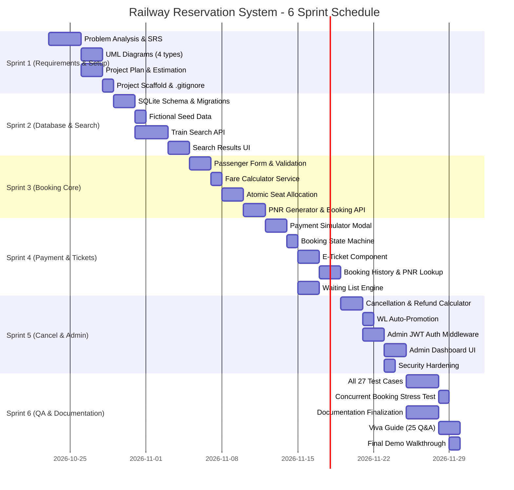

# Project Plan (SPMP) — Railway Reservation System (Team 11)
**Course:** CSE 2271 | Presidency University, Bengaluru  
**Standard Reference:** IEEE 1058-1998 (Software Project Management Plans)

---

## 1. Project Objectives

1. Deliver a fully functional, academically rigorous Railway Reservation System demonstrating end-to-end booking lifecycle.
2. Apply and evidence all CSE 2271 Software Design & Development course concepts.
3. Produce reproducible, documented, testable code suitable for faculty inspection and viva examination.
4. Complete all 17 documentation deliverables and 27 automated test scenarios.

---

## 2. In-Scope and Out-of-Scope Features

### In-Scope
- Train schedule search with route ordering and overnight handling.
- Atomic seat allocation with concurrency protection.
- Multi-passenger booking (1–6 passengers).
- Simulated payment (success, failure, cancellation).
- Unique PNR generation and digital e-ticket.
- Waiting-list queuing and FIFO promotion.
- Tiered cancellation and refund calculation.
- Protected administrator portal.
- Automated test suite (27 test cases).
- Academic documentation package (18 docs).

### Out-of-Scope
- Live IRCTC / Indian Railways integration.
- Real payment gateway (Razorpay, PayU, etc.).
- Tatkal quota, senior citizen concessions, military quotas.
- Real email/SMS delivery of tickets.
- Mobile native applications.

---

## 3. Work Breakdown Structure (WBS)

```
Railway Reservation System (Project)
├── WP-01: Requirements & Feasibility
│   ├── Problem statement analysis
│   ├── Stakeholder identification
│   ├── Elicitation technique application
│   └── Deliverable: docs/SRS.md
├── WP-02: SRS & UML Modelling
│   ├── FR & NFR specification (FR-01 to FR-20)
│   ├── Use Case Diagram (PlantUML + Mermaid)
│   ├── Activity Diagram
│   ├── Swimlane Diagram
│   ├── ER Diagram
│   └── Deliverable: docs/UML_DIAGRAMS.md + docs/diagrams/*.puml
├── WP-03: Architecture & Database Design
│   ├── Layered architecture specification
│   ├── Normalized schema design (13 tables)
│   ├── State machine definition
│   └── Deliverable: docs/ARCHITECTURE.md, docs/DATABASE_DESIGN.md
├── WP-04: Frontend Foundation
│   ├── Vite + React + TypeScript scaffold
│   ├── Tailwind CSS design system
│   ├── React Router v6 routing
│   └── Deliverable: client/ directory with routing working
├── WP-05: Backend Foundation
│   ├── Express + TypeScript server
│   ├── SQLite schema migration
│   ├── Seed data loading
│   ├── Error handling middleware
│   └── Deliverable: server/ with GET /api/health working
├── WP-06: Search & Availability Engine
│   ├── Train search API with route ordering
│   ├── Overnight journey calculation
│   ├── Filter & sort implementation
│   └── Deliverable: GET /api/trains/search returning results
├── WP-07: Booking & Passenger Validation
│   ├── Passenger form & server-side validation
│   ├── Fare calculation engine
│   ├── Atomic seat allocation transaction
│   ├── Idempotency key implementation
│   └── Deliverable: POST /api/bookings creating bookings
├── WP-08: Payment Simulation
│   ├── Payment modal UI (success/failure/cancel)
│   ├── Payment state recording
│   ├── Booking state transition on payment result
│   └── Deliverable: POST /api/payments with full state machine
├── WP-09: E-Ticket & Booking History
│   ├── PNR generation (10-char unique)
│   ├── E-ticket display component
│   ├── Booking lookup by PNR + contact
│   └── Deliverable: GET /api/bookings/:pnr returning ticket
├── WP-10: Waiting List Management
│   ├── WL detection and offer
│   ├── WL queue with FIFO ordering
│   ├── WL position display
│   └── Deliverable: WL booking flow end-to-end
├── WP-11: Cancellation & Refund Engine
│   ├── Tiered refund calculator
│   ├── Inventory release on cancellation
│   ├── WL promotion trigger
│   └── Deliverable: POST /api/bookings/:pnr/cancel working
├── WP-12: Administrator Functions
│   ├── JWT auth middleware
│   ├── Train/schedule/inventory management APIs
│   ├── Admin dashboard UI
│   └── Deliverable: /api/admin/* protected endpoints
├── WP-13: Testing & Security Review
│   ├── 27 Vitest + Supertest test cases
│   ├── Concurrent booking test
│   ├── Authorization bypass tests
│   └── Deliverable: docs/TEST_PLAN.md + passing test suite
└── WP-14: Documentation & Demonstration
    ├── All 18 documentation files
    ├── Viva question bank (25+ Q&A)
    └── Deliverable: docs/VIVA_AND_DEMO_GUIDE.md
```

---

## 4. Six-Sprint Schedule



---

## 5. Critical Path Analysis

**Activity Network (key tasks only, showing critical path):**

| Task ID | Task | Duration (days) | Predecessors | ES | EF | LS | LF | Float |
| :--- | :--- | :--- | :--- | :--- | :--- | :--- | :--- | :--- |
| A | Problem Analysis & SRS | 3 | — | 0 | 3 | 0 | 3 | **0 (Critical)** |
| B | Schema Design | 2 | A | 3 | 5 | 3 | 5 | **0 (Critical)** |
| C | Seed Data | 1 | B | 5 | 6 | 5 | 6 | **0 (Critical)** |
| D | Train Search API | 3 | B | 5 | 8 | 5 | 8 | **0 (Critical)** |
| E | Passenger Validation | 2 | D | 8 | 10 | 8 | 10 | **0 (Critical)** |
| F | Atomic Seat Allocation | 2 | E | 10 | 12 | 10 | 12 | **0 (Critical)** |
| G | Payment Simulator | 2 | F | 12 | 14 | 12 | 14 | **0 (Critical)** |
| H | E-Ticket & History | 2 | G | 14 | 16 | 14 | 16 | **0 (Critical)** |
| I | WL Engine | 2 | G | 14 | 16 | 15 | 17 | 1 (Float) |
| J | Cancellation & Refund | 2 | H | 16 | 18 | 16 | 18 | **0 (Critical)** |
| K | WL Promotion | 1 | J | 18 | 19 | 18 | 19 | **0 (Critical)** |
| L | Admin & Security | 3 | K | 19 | 22 | 19 | 22 | **0 (Critical)** |
| M | Testing Suite | 3 | L | 22 | 25 | 22 | 25 | **0 (Critical)** |
| N | Documentation & Demo | 3 | L | 22 | 25 | 22 | 25 | **0 (Critical)** |

**Critical Path:** A → B → D → E → F → G → H → J → K → L → M/N  
**Minimum Project Duration:** 25 working days (adjustable to academic calendar)

---

## 6. Roles and Responsibilities

| Role | Person | Responsibility |
| :--- | :--- | :--- |
| Product Owner | Student Developer | Requirements prioritization, backlog grooming |
| Scrum Master | Student Developer | Sprint planning, retrospective facilitation |
| Developer | Student Developer | Full-stack implementation |
| QA Engineer | Student Developer | Test design and execution |
| Faculty Evaluator | Course Instructor | Academic acceptance criteria |

---

## 7. Risk Summary

| Risk ID | Risk | Likelihood | Impact | Mitigation |
| :--- | :--- | :--- | :--- | :--- |
| R-01 | Race condition in seat allocation | High | Critical | `BEGIN IMMEDIATE` SQLite transactions |
| R-02 | Duplicate payment execution | Medium | High | Idempotency key UNIQUE constraint |
| R-03 | Schedule overrun | Medium | High | MoSCoW prioritization of Must-Haves |
| R-04 | Unauthorized admin access | Low | Critical | JWT middleware on all `/api/admin/*` routes |

*Full risk analysis in `docs/RISK_REGISTER.md`.*
