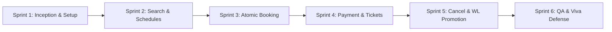

# Software Development Life Cycle (SDLC) & Process Model
**Academic Institution:** Presidency University, Bengaluru  
**Department:** Computer Science and Engineering  
**Course:** Software Design and Development (CSE 2271)  
**Project:** Team 11 — Railway Reservation System  
**Primary Reference:** Rajib Mall, *Fundamentals of Software Engineering*, 5th Ed., PHI Learning; Course Lecture Notes for Module 1.

---

## 1. Selected Primary Process Model: Iterative & Incremental Scrum-Inspired Model

For the Team 11 Railway Reservation System, we select an **Iterative and Incremental Development Process inspired by the Agile Scrum framework** as our primary SDLC model.

### 1.1 Justification for Selection
Railway reservation software contains mission-critical business logic that combines user-facing workflows with sensitive state management:
1. **Incremental Delivery of Business Value:** Complex features (train search, seat allocation, simulated payment, waiting-list promotion, and administrative oversight) cannot safely be constructed in a single monolithic phase. An incremental approach delivers a functioning core (Search & Seat Availability) first, followed by successive increments (Booking & Payment $\to$ Waiting List $\to$ Cancellation & Refund).
2. **Early Validation of Core Risks:** High-risk algorithmic behaviors—such as race conditions in seat allocation and the state-machine rules of ticket promotion—must be validated experimentally early in the lifecycle rather than discovered at system delivery.
3. **Continuous Verification and Phase Containment:** Each sprint produces a testable release increment verified through automated regression suites, preventing defect propagation from requirements into deployment.
4. **Academic Project Constraints:** Sprints allow a structured timeline (6 defined two-week equivalent iterations) aligned with university milestones while maintaining full adaptability to feedback.

---

## 2. Supporting Engineering Techniques and Selective Hybridization

To claim that multiple independent process models (Waterfall, Spiral, V-Model, Prototyping, Agile) are simultaneously used as primary SDLCs is academically invalid. Instead, our primary Agile/Scrum process is selectively strengthened by supporting techniques borrowed from classical models:

```
+-----------------------------------------------------------------------------------+
|               PRIMARY SDLC: Iterative & Incremental Scrum Backbone                |
|                    (6 Sprints: S1 Foundation -> S6 Verification)                  |
+-----------------------------------------------------------------------------------+
        |                           |                           |
        v                           v                           v
+------------------+       +------------------+       +-------------------+
|   Prototyping    |       |   Spiral Risk    |       |      V-Model      |
|    Technique     |       |    Assessment    |       |     Alignment     |
+------------------+       +------------------+       +-------------------+
| Used in Sprint 1 |       | Applied to Con-  |       | Requirements      |
| for Station      |       | currency, Race   |       | mapped 1-to-1 to  |
| Selectors & Seat |       | Conditions, and  |       | Acceptance Tests  |
| Booking UI       |       | Refund Integrity |       | for Phase Quality |
+------------------+       +------------------+       +-------------------+
```

1. **Prototyping Technique (Sprint 1):** Employed exclusively for early user-interface validation of train search forms, seat layout cards, and payment flow ergonomics. This resolved ambiguity before backend API freezing.
2. **Spiral Risk-Driven Cycles:** Borrowed from Boehm's Spiral model to conduct risk identification and mitigation spikes for high-risk technical concerns:
   - *Risk 1:* Concurrent double-booking of the last remaining seat.
   - *Risk 2:* Payment failure leaving orphaned reserved inventory.
   - *Risk 3:* Inconsistent refund recalculation during partial ticket cancellation.
3. **V-Model Verification Alignment:** For every formal requirement specified in the SRS, a corresponding verification test case was designed upfront, enforcing phase-containment of defects.
4. **Automated Regression Testing:** Every iteration executes existing test suites to ensure new increments do not regress prior functionality.

---

## 3. Comprehensive Comparison of SDLC Models

The following comparative analysis evaluates the candidate process models against the domain requirements of the Railway Reservation System:

| Process Model | Characteristics | Major Strengths | Critical Weaknesses | Suitability for Team 11 Railway System |
| :--- | :--- | :--- | :--- | :--- |
| **Classical Waterfall** | Strictly linear, sequential phases; no backward iteration; documents drive each stage. | Simple to understand; clear milestone boundaries and documentation. | Prohibits requirement changes; testing occurs at the very end; high probability of late catastrophic failure. | **Unsuitable as primary.** Fails to accommodate iterative clarification of complex waiting-list and refund business rules. |
| **Iterative Waterfall** | Linear phases with feedback paths to immediately preceding phases for defect correction. | Introduces feedback loops; maintains disciplined documentation structure. | Feedback is rigid and locally constrained; working software is deferred until late in the lifecycle. | **Partially relevant.** The feedback mechanism informs our sprint retrospectives, but does not provide adequate agility. |
| **Prototyping Model** | Requirements elicitation through throwaway or evolutionary mockups before coding. | Excellent for clarifying vague requirements and user ergonomics. | Risk of user confusing mockup with real system; can encourage poor architectural foundations if prototype is retained. | **Adopted as a supporting technique.** Used strictly in Sprint 1 to validate booking wizards and responsive layouts. |
| **Spiral Model** | Meta-model combining waterfall discipline with iterative prototyping guided by risk assessment. | Explicit risk management at every cycle; prevents catastrophic architectural mistakes. | Complex management overhead; excessive for small academic project if followed rigidly. | **Adopted for risk spikes.** The risk-assessment quadrant directly guided our concurrency and transaction design. |
| **V-Model** | Emphasizes verification and validation; pairs development phases symmetrically with test levels. | Explicit test planning upfront; excellent defect containment and traceability. | Inflexible to changing requirements; rigid waterfall-style phasing under standard formulation. | **Adopted for quality mapping.** SRS clauses directly map to unit, integration, and system test cases. |
| **Agile / Scrum (Selected)** | Iterative and incremental delivery of cross-functional working software in timeboxed sprints. | Rapid feedback; early working increments; high adaptability; continuous quality inspection. | Requires discipline in documentation; scope creep risk if Product Owner boundaries are absent. | **Selected as Primary.** Best balance of early working functionality, incremental risk reduction, and rigorous validation. |

---

## 4. Project-Specific Advantages and Limitations

### 4.1 Advantages for Railway Reservation System
- **Early Delivery of Testable Increments:** The core engine (train search, schedule lookup, fare quotes) was verified as working software in Sprint 2 before adding complex transactional booking in Sprint 3.
- **Fail-Fast Concurrency Validation:** Concurrency stress-testing on seat inventory occurred in Sprint 3, allowing database isolation levels (`BEGIN IMMEDIATE` transactions in SQLite) to be locked in early.
- **Modular Refactoring:** As cancellation rules evolved to include waiting-list promotion, the modular design permitted localized service enhancements without rewriting the search engine.

### 4.2 Limitations & Mitigations
- **Academic Documentation Overhead:** Pure Agile can de-emphasize formal documentation. *Mitigation:* We established living documentation files (`docs/SRS.md`, `docs/ARCHITECTURE.md`) updated synchronously with each sprint's Definition of Done.
- **Solo/Small Team Role Representation:** Standard Scrum assumes separate full-time Product Owner, Scrum Master, and Team roles. *Mitigation:* Team roles were represented as explicit procedural responsibilities with documented handoffs rather than pretending a large organizational hierarchy existed.

---

## 5. Planned Lifecycle Phases and Exit Criteria

The 6-sprint lifecycle defines strict entry and exit criteria for each phase:



### Phase Details

#### Sprint 1: Inception, Requirements & Architectural Setup
- **Scope:** Problem framing, SRS formulation, UML modeling, tech stack scaffolding, repository structure.
- **Entry Criteria:** Approved problem statement and CSE 2271 course guidelines.
- **Exit Criteria:** Approved `docs/SRS.md`, `docs/UML_DIAGRAMS.md`, functional monorepo structure, zero lint errors.

#### Sprint 2: Data Persistence, Train Schedules & Search Engine
- **Scope:** SQLite schema migration, deterministic seed data, station route ordering, train search API with filtering and sorting.
- **Entry Criteria:** Frozen database schema design in `docs/DATABASE_DESIGN.md`.
- **Exit Criteria:** Passing automated tests for station search, route ordering, overnight journey duration calculation, and fare quotes.

#### Sprint 3: Passenger Validation, Seat Allocation & Atomic Booking
- **Scope:** Passenger detail forms, server-side validation, atomic seat reservation transactions, idempotency handling.
- **Entry Criteria:** Functioning search API and inventory tables.
- **Exit Criteria:** Zero-overbooking concurrency tests passing; valid PNR generation; idempotency protection verified.

#### Sprint 4: Payment Simulation, E-Tickets & Booking History
- **Scope:** Payment gateway simulator (success, failure, timeout), booking state transitions, demonstration e-ticket view, booking lookup.
- **Entry Criteria:** Transactional booking service producing pending reservations.
- **Exit Criteria:** Failed payment cleanly rolls back or releases inventory; successful payment issues formatted e-ticket; test suite passes.

#### Sprint 5: Cancellations, Refunds, Waiting-List Promotion & Admin Portal
- **Scope:** Cancellation rules engine, refund calculation, waiting-list promotion trigger, protected admin dashboard.
- **Entry Criteria:** Functional end-to-end booking and ticketing lifecycle.
- **Exit Criteria:** Cancellation accurately calculates tiered deductions; freed seat automatically promotes first queued WL passenger; admin routes secured.

#### Sprint 6: System Integration, Security Audit & Viva Preparation
- **Scope:** End-to-end integration tests, accessibility/usability audit, viva question bank, demonstration script.
- **Entry Criteria:** Feature-complete codebase with all core user stories in Implemented state.
- **Exit Criteria:** 100% passing test suite across 27 scenarios; zero unhandled exceptions; verified reproducibility guide in `docs/VIVA_AND_DEMO_GUIDE.md`.

---

## 6. Development Phases and Testing Relationship (V-Model Alignment)

To maintain rigorous academic quality, each development phase is strictly mapped to its corresponding verification level:

```
Development Life Cycle                              Testing Life Cycle
======================                              ==================

[1. Requirements (SRS)] <-------------------------> [System & Acceptance Testing]
         \                                                    /
  [2. Architecture & High Design] <-------------> [Integration Testing]
             \                                        /
      [3. Detailed Module Design] <---------> [Module / Service Testing]
                 \                                /
          [4. Implementation / Code] <-----> [Unit Testing]
```

1. **SRS Requirements $\leftrightarrow$ Acceptance Testing:** FR-01 through FR-20 validated via end-to-end API tests and UI workflow checks.
2. **Architecture $\leftrightarrow$ Integration Testing:** Verification of Express controllers communicating seamlessly with SQLite and simulated payment services.
3. **Module Design $\leftrightarrow$ Service Testing:** Verification of `SeatAllocationService`, `RefundService`, and `WaitingListService` in isolation.
4. **Implementation $\leftrightarrow$ Unit Testing:** Verification of utility functions (station distance calculations, date boundary checkers, PNR formatters).

---

## 7. Phase Containment of Errors

Phase containment of errors is the software engineering practice of detecting and eliminating defects in the exact lifecycle phase in which they originate, preventing exponential defect escalation costs.

```
Cost to Fix
Defect ($)
  |                                                     * (Post-Release: 100x)
  |                                           * (Testing: 20x)
  |                               * (Coding: 5x)
  |                   * (Design: 2x)
  |       * (Requirements: 1x)
  +------------------------------------------------------------> Phase
```

### Application in Team 11 Project

| Originating Phase | Defect Example Detected | Detection Mechanism | Containment Action Taken | Escalation Prevented |
| :--- | :--- | :--- | :--- | :--- |
| **Requirements** | Ambiguity regarding whether WL tickets pay full fare upfront. | Requirements walkthrough against IRCTC guidelines. | Updated SRS Section 3.2: WL tickets pay full fare upfront and receive full refund minus clerical fee if unconfirmed. | Prevented backend architectural redesign during payment implementation. |
| **Design** | Two concurrent passengers reserving the last seat simultaneously. | Spiral risk assessment of SQLite default locking. | Mandated `BEGIN IMMEDIATE` transaction lock in `BookingRepository.ts`. | Prevented production overbooking and corrupted inventory states. |
| **Implementation** | Arrival time displayed as same date for overnight trains (e.g., depart 22:00, arrive 04:30). | Unit test on route day-offset logic. | Added `day_offset` attribute to `train_routes` schema and display logic. | Prevented confusing passenger UI and incorrect itinerary presentation. |
| **Testing** | Admin dashboard accessible without authentication header. | Supertest HTTP integration test. | Enforced `requireAdminAuth` middleware on all `/api/admin/*` endpoints. | Contained security authorization flaw prior to faculty demonstration. |

---

## 8. Software Maintenance Plan

The project includes an operational maintenance strategy covering the three IEEE/ISO maintenance categories:

### 8.1 Corrective Maintenance (Bug Fixing)
- **Objective:** Fix residual defects discovered during faculty evaluation or continuous testing.
- **Workflow:** Defect logged in Issue Tracker $\to$ Reproduction test written in Vitest $\to$ Code patched $\to$ Regression suite rerun $\to$ Version incremented.
- **Example:** Handling edge cases in leap-year journey dates or non-standard phone number inputs.

### 8.2 Adaptive Maintenance (Environment Changes)
- **Objective:** Ensure the system continues functioning when external environments, Node.js runtimes, or browser standards change.
- **Workflow:** Dependency vulnerability scans via `npm audit`; updating SQLite driver if Node runtime updates; maintaining cross-browser responsive layouts.
- **Example:** Ensuring seamless execution on both Node.js v20 LTS and Node.js v24.

### 8.3 Perfective Maintenance (Enhancements)
- **Objective:** Enhance performance, user experience, and feature richness without altering core business rules.
- **Workflow:** Backlog grooming of 'Could Have' user stories $\to$ Implementation in post-course release increments.
- **Example:** Adding interactive graphical coach seat map selector, dynamic Tatkal quota pricing, and PDF e-ticket export.

---

## 9. Change Management and Feedback Handling

To control scope volatility while remaining responsive to academic feedback:
1. **Change Request Logging:** All proposed changes (e.g., faculty suggestions during milestone reviews) are documented as formal Change Requests (CRs).
2. **Impact Analysis:** Evaluated against: (a) Database schema impact, (b) Architectural coupling, (c) Regression test impact, and (d) Delivery timeline.
3. **Approval & Backlog Insertion:** Approved CRs are inserted into the Sprint Backlog with updated acceptance criteria; rejected CRs are documented in the out-of-scope register.
