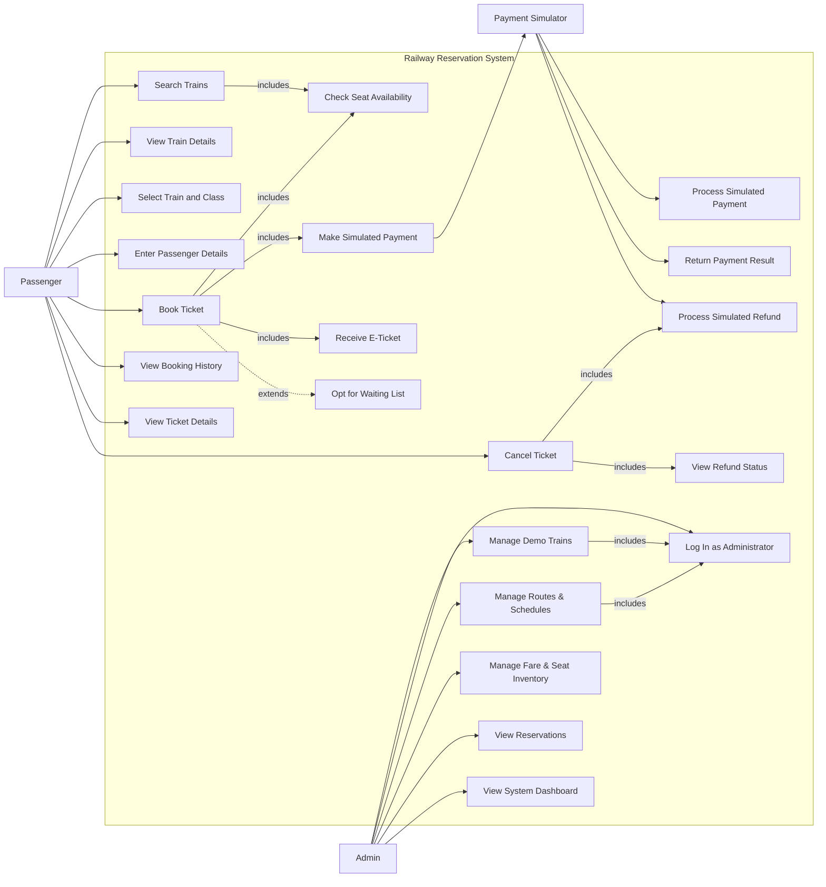
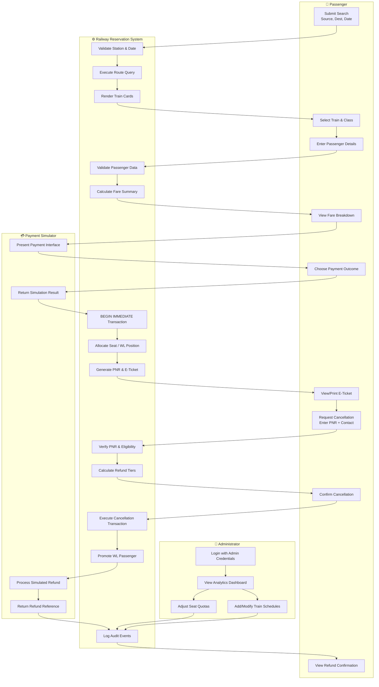
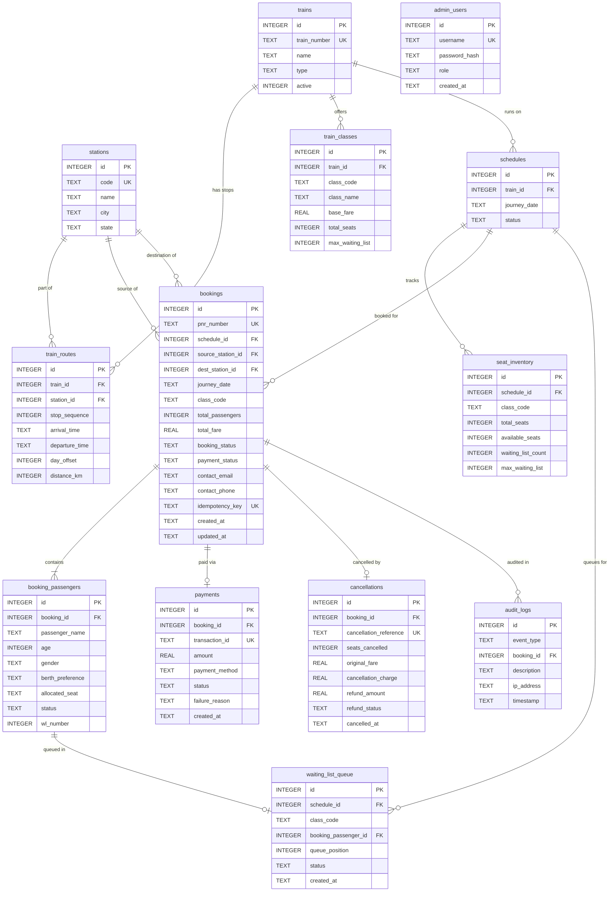

# UML Diagrams — Railway Reservation System (Team 11)
**Course:** Software Design and Development (CSE 2271) | Presidency University, Bengaluru  
**Tool:** PlantUML source files in `docs/diagrams/` — render at https://www.plantuml.com/plantuml/uml/ or via VS Code PlantUML extension.

---

## 1. Use Case Diagram

> The Use Case Diagram captures the external actors and the functional goals they pursue within the system boundary. It uses `<<include>>` for mandatory sub-goals, `<<extend>>` for conditional optional paths, and directed associations for actor-to-use-case relationships. (Source: Ivar Jacobson's use-case methodology, as covered in Module 2 course notes.)

> **Semantic Notes:**
> - `<<include>>` is used for mandatory sub-behaviours that always execute as part of the parent use case (e.g., `Check Seat Availability` is always executed when `Book Ticket` runs).
> - `<<extend>>` is used for optional/conditional additions (e.g., `Opt for Waiting List` only extends `Book Ticket` when confirmed seats are unavailable).
> - All administrative actions include `Log In as Administrator` because they require prior authorization.

---

## 2. Activity Diagram — Complete Booking & Cancellation Workflow

> The Activity Diagram models the sequential control flow of the booking and cancellation lifecycle, showing decision branches, action states, and final outcomes. Fork/join bars are intentionally NOT used for booking commit because seat allocation, payment recording, and ticket generation must occur sequentially within a single database transaction — not in parallel.

```mermaid
flowchart TD
    Start([🟢 Start]) --> A[Enter Source, Destination, Travel Date]
    A --> B{Valid Parameters?}
    B -- No --> C[Display Validation Error\nSame Station or Past Date]
    C --> End1([🔴 Stop])
    B -- Yes --> D[Query Train Routes & Schedules]
    D --> E{Matching Trains Found?}
    E -- No --> F[Display: No Direct Trains Found]
    F --> End2([🔴 Stop])
    E -- Yes --> G[Display Trains, Times, Fares, Availability]
    G --> H[Select Train and Travel Class]
    H --> I[Enter Passenger Details]
    I --> J{Details Valid?}
    J -- No --> K[Display Passenger Validation Errors]
    K --> End3([🔴 Stop])
    J -- Yes --> L[Calculate Fare Breakdown]
    L --> M[Recheck Real-Time Seat Availability]
    M --> N{CNF Seats Available?}
    N -- Yes --> O[Set Status: CONFIRMED]
    N -- No --> P{WL Capacity Available?}
    P -- No --> Q[Display: Train Fully Booked]
    Q --> End4([🔴 Stop])
    P -- Yes --> R{Accept Waiting List?}
    R -- No --> S[Booking Aborted by User]
    S --> End5([🔴 Stop])
    R -- Yes --> T[Set Status: WAITING_LIST]
    O --> U[Open Simulated Payment Modal]
    T --> U
    U --> V{Payment Outcome?}
    V -- Failure/Decline --> W[Display Payment Failed\nRelease Held Inventory\nLog Audit Event]
    W --> End6([🔴 Stop: No Ticket Created])
    V -- User Cancelled --> X[Display Cancelled\nRelease Held State]
    X --> End7([🔴 Stop])
    V -- Payment Success --> Y[BEGIN IMMEDIATE Transaction]
    Y --> Z{Booking Type?}
    Z -- Confirmed --> AA[Decrement Available Seats\nAssign Coach & Berth Numbers]
    Z -- Waiting List --> AB[Increment WL Count\nAssign FIFO Queue Position]
    AA --> AC[Generate Unique PNR Number]
    AB --> AC
    AC --> AD[Save Booking & Passenger Records]
    AD --> AE[Record Successful Payment]
    AE --> AF[Log Audit Event]
    AF --> AG[Render Digital E-Ticket]
    AG --> AH[User Views / Prints E-Ticket]
    AH --> AI{Cancel Ticket?}
    AI -- No --> End8([🟢 Journey Completed])
    AI -- Yes --> AJ[Verify PNR & Check Eligibility]
    AJ --> AK{Eligible for Cancellation?}
    AK -- No --> AL[Display: Ineligible / Past Journey]
    AL --> End9([🔴 Stop])
    AK -- Yes --> AM[Calculate Refund by Time Window]
    AM --> AN[Display Refund Summary & Deductions]
    AN --> AO{Confirm Cancellation?}
    AO -- No --> AP[Cancellation Aborted]
    AP --> End10([🔴 Stop])
    AO -- Yes --> AQ[Mark Booking CANCELLED]
    AQ --> AR{Was CNF Ticket?}
    AR -- Yes --> AS[Release Seat to Inventory]
    AS --> AT{WL Passengers Queued?}
    AT -- Yes --> AU[Promote WL-1 to CONFIRMED\nAssign Freed Seat\nRenumber Remaining WL]
    AT -- No --> AV[Process Simulated Refund]
    AU --> AV
    AR -- WL Ticket --> AW[Decrement WL Count & Renumber]
    AW --> AV
    AV --> AX[Display Refund Reference & Confirmation]
    AX --> End11([🟢 Stop])
```

---

## 3. Swimlane Activity Diagram — Responsibility Handoffs

> A Swimlane Activity Diagram augments the Activity Diagram by explicitly partitioning actions across organizational roles or system boundaries. It shows **who** is responsible for each action, making architectural boundaries and handoffs immediately visible to reviewers.

---

## 4. Entity-Relationship (ER) Diagram

> The ER Diagram maps the normalized relational schema of the SQLite database. Each entity corresponds directly to a database table defined in `server/src/db/schema.sql`.

---

## 5. Diagram Rendering Instructions

| Diagram | Source File | Render Method |
| :--- | :--- | :--- |
| Use Case Diagram | `docs/diagrams/use-case-diagram.puml` | PlantUML Online Server or VS Code Extension |
| Activity Diagram | `docs/diagrams/activity-diagram.puml` | PlantUML Online Server or VS Code Extension |
| Swimlane Diagram | `docs/diagrams/swimlane-diagram.puml` | PlantUML Online Server or VS Code Extension |
| ER Diagram | `docs/diagrams/er-diagram.puml` | PlantUML Online Server or VS Code Extension |

**PlantUML Online:** Paste `.puml` content at https://www.plantuml.com/plantuml/uml/  
**VS Code:** Install *PlantUML* extension by jebbs, then use `Alt+D` to preview.
